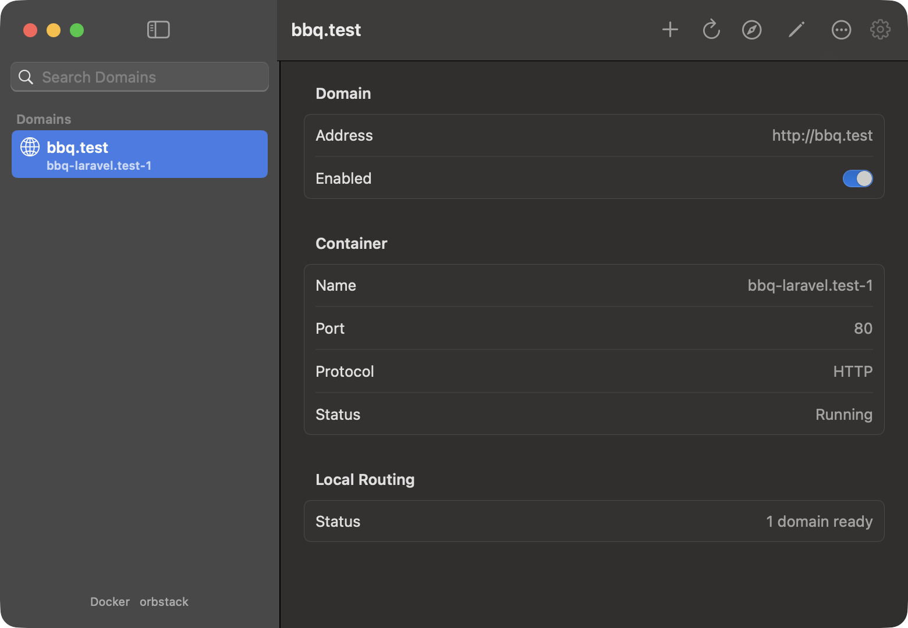

# Docker Domains

A native macOS menu bar app that gives your Docker containers real local domain names. No more `localhost:8080`, `localhost:5173` and `localhost:3000`:

```text
myapp.test       → myapp-web-1     :80
studio.test      → studio-web-1    :3000
vite.myapp.test  → myapp-vite-1    :5173
```



- Works with **OrbStack** and **Docker Desktop**.
- Serves any HTTP app: Laravel, Nuxt, Rails, WordPress, Node, and so on.
- Containers **don't need published ports**, and several containers can use the same internal port.
- Never edits your Compose files, project files or existing Docker networks.
- Supports WebSockets and streaming responses, so HMR and SSE keep working.

## Requirements

| | |
|---|---|
| macOS | 14 (Sonoma) or later |
| Swift toolchain | Xcode, or the Swift 6 command line tools (`xcode-select --install`) |
| Docker engine | 28 or later (API 1.48+), running locally via OrbStack or Docker Desktop |
| Port 80 | Free on `127.0.0.1` |

## Quick start

### 1. Build and install

```sh
git clone https://github.com/genericmilk/docker-domains.git
cd docker-domains
./scripts/build.sh --install
open "$HOME/Applications/Docker Domains.app"
```

This builds a release binary, packages it as `~/Applications/Docker Domains.app`, and signs it ad hoc for your Mac. A network icon appears in the menu bar. The app has no Dock icon.

### 2. Set up local routing (once)

1. Click the menu bar icon and choose **Manage Domains…**.
2. Under **Local Routing**, click **Set Up…**. (You can also use **Set Up Local Domains…** in **Settings…**.)
3. Approve the macOS prompt with Touch ID or your administrator password.

This creates `/etc/resolver/test`, which tells macOS to send `.test` lookups to the app. You only need to do this once. Adding domains later needs no further prompts.

### 3. Add a domain

1. Make sure your project's containers are running (for example, `docker compose up -d`).
2. Click **+** (**Add Domain…**) in the toolbar.
3. Enter a domain ending in `.test`, such as `myapp.test`.
4. Pick the container.
5. Enter the port the app listens on **inside the container**. This is not the published host port. For a container published as `8080->80`, enter `80`.

### 4. Open it

Visit **http://myapp.test** in your browser. The first mapping downloads a small Caddy image, which takes a few seconds.

## Make your dev server accept the new domain

The app routes traffic but deliberately leaves your project settings alone. You may need to change a few things yourself:

- **Listen on all interfaces.** The server must bind to `0.0.0.0` inside its container, not `127.0.0.1`.
- **Allow the host.** If your dev server checks hostnames (Vite's `server.allowedHosts`, Rails' `config.hosts`, and so on), add your `.test` domain.
- **Laravel:** set `APP_URL=http://myapp.test` if the app generates absolute URLs or redirects.
- **Vite/HMR in a separate container:** keep its existing HMR address, or map a second domain (such as `vite.myapp.test`) and configure the dev server to advertise it.

## Day-to-day use

- **Keep the app running.** Its DNS server lives in the menu bar process. If you quit, `.test` names stop resolving until you reopen it.
- **Disable one domain** with its **Enabled** toggle or context menu.
- **Pause everything** with **Pause Routing** in the menu bar menu. This also frees port 80.
- **Stopped containers** still appear in the list, and you can start them from the app. This starts only that container, not the rest of its Compose project, so start databases and other services as usual.
- **Container recreation** (`docker compose up --force-recreate`, rebuilds) is picked up automatically within about five seconds.
- **Launch at login** is available in **Settings…**.

## Troubleshooting

| Problem | Fix |
|---|---|
| Port 80 conflict reported | Another service (MAMP, Valet, nginx, another proxy) holds port 80. Stop it, or pause it while using Docker Domains. The app never stops other services for you. |
| `myapp.test` doesn't resolve | Check the app is running. Then run `dscacheutil -q host -a name myapp.test`, which should return `127.0.0.1`. Plain `dig myapp.test` ignores macOS's per-domain resolvers, so it isn't a reliable test. Use `dig @127.0.0.1 -p 53535 myapp.test` to query the app directly. |
| Bad Gateway / 502 | The port is wrong or the server inside the container listens on `127.0.0.1`. Use the internal port and bind to `0.0.0.0`. |
| Container marked unsupported | Containers using `host`, `none`, or shared-container network modes can't be routed. Use a bridge network. |
| Switched Docker context | The Docker context is fixed when the app starts. Relaunch the app after switching. Only local Unix-socket contexts are supported. |
| Redirects to the old URL | Update your framework's app URL setting, such as Laravel's `APP_URL`. |

## How it works

- **DNS.** The app runs a small authoritative DNS server on `127.0.0.1:53535` (UDP and TCP). `/etc/resolver/test` points macOS at it for the reserved `.test` suffix. `.test` A records resolve to `127.0.0.1`. Other record types return no data, other suffixes are refused, and nothing is forwarded.
- **Proxy.** A managed `caddy:2.10.2-alpine` container listens on `127.0.0.1:80` and routes by HTTP `Host` header, preserving paths, queries, WebSockets and streaming responses. Local URLs use HTTP. The optional upstream HTTPS setting is only for targets that serve TLS with a certificate Caddy trusts.
- **Networking.** Mapped containers join a managed `docker-domains` bridge network with unique aliases and lower gateway priority, so their existing default route is unchanged. Containers on this bridge can reach each other.
- **Discovery.** Docker is polled every five seconds. Mappings match by container name, falling back to Compose project and service, so recreated containers are found again. Ambiguous replicas are never picked automatically.
- **Storage.** Configuration lives in `~/Library/Application Support/Docker Domains/`. Mappings are written atomically to `mappings.json`. The proxy mounts only the `proxy/` subdirectory, read-only, and never gets the Docker socket.

### About the authorization prompt

Setup uses Apple's `authopen` tool to create `/etc/resolver/test`, so macOS can offer Touch ID with an administrator password fallback. The app never sees your password or fingerprint, and it doesn't touch PAM, sudo, or system authorization rules. On a fresh Mac where `/etc/resolver` doesn't exist yet, creating that directory needs one extra standard administrator prompt. An existing correct setup is detected without prompting. Conflicting resolver files and symbolic links are left untouched.

## Uninstall

1. Open **Settings…** from the menu bar icon and click **Remove Local Setup…**. This removes the resolver file, the proxy container and the managed bridge network (admin approval is needed for the resolver file). Your app containers and saved mappings are kept. Resources that happen to share the app's names but lack its ownership label are left alone.
2. Quit the app and delete it:

   ```sh
   rm -rf "$HOME/Applications/Docker Domains.app"
   rm -rf "$HOME/Library/Application Support/Docker Domains"   # optional: saved mappings
   ```

If you only quit the app, the Docker proxy keeps running. Pause or remove setup before switching to another local routing tool.

## Development

```sh
swift build                 # debug build
swift test                  # unit tests
./scripts/build.sh          # release .app in dist/ (without installing)
```

Open the management window directly on launch:

```sh
open "$HOME/Applications/Docker Domains.app" --args --show-window
```

### Integration tests

```sh
DOCKER_DOMAINS_INTEGRATION=1 swift test --filter DockerIntegrationTests
```

These need port 80 free and no existing Docker Domains proxy (an existing one is left untouched). The test starts two disposable Node HTTP servers with no published ports, checks Host routing, paths and queries, SSE, WebSocket upgrades, restart and recreation, pausing, and cleanup, then removes everything it created.

### Signing for distribution

The build signs ad hoc by default. Set `SIGNING_IDENTITY` to a Developer ID identity to sign for distribution. Notarization is a separate step.

```sh
SIGNING_IDENTITY="Developer ID Application: Your Name (TEAMID)" ./scripts/build.sh
```

### Project layout

```text
Sources/DomainCore/      Docker API client, DNS message parsing, models, resolver file handling
Sources/DockerDomains/   SwiftUI app, menu bar, DNS server, app state
Tests/DomainCoreTests/   Unit tests and the opt-in Docker integration test
scripts/                 build.sh (package/sign/install) and icon generation
```
